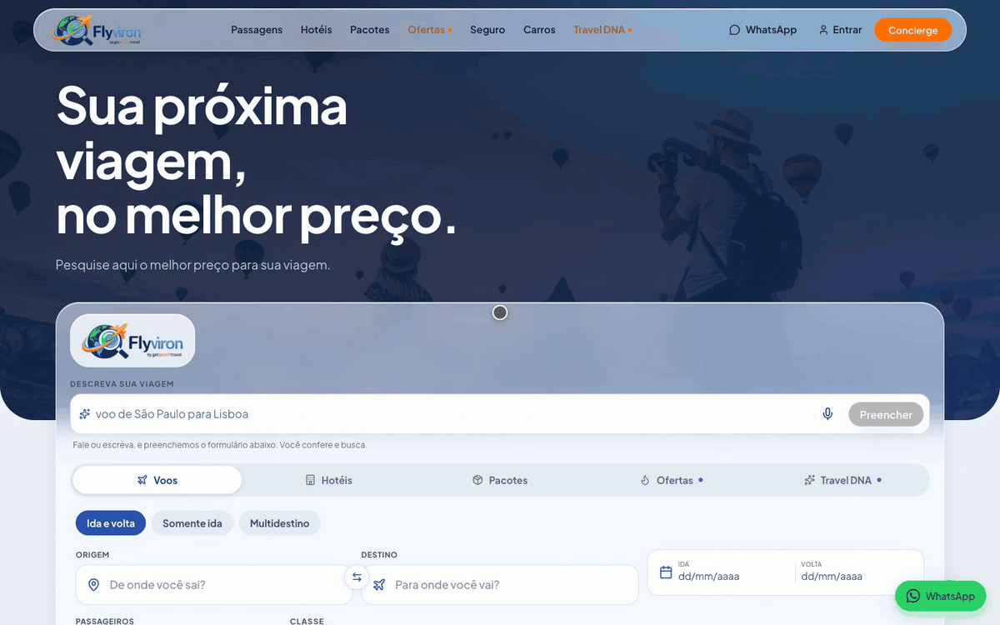
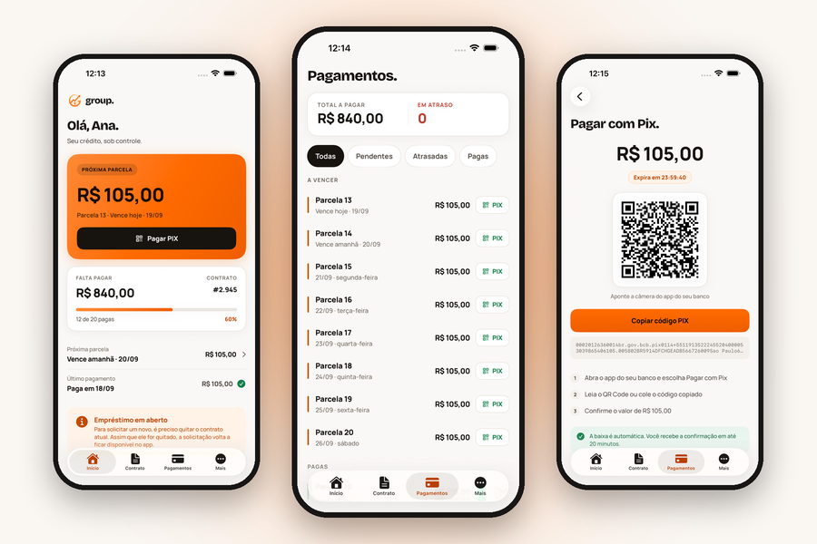
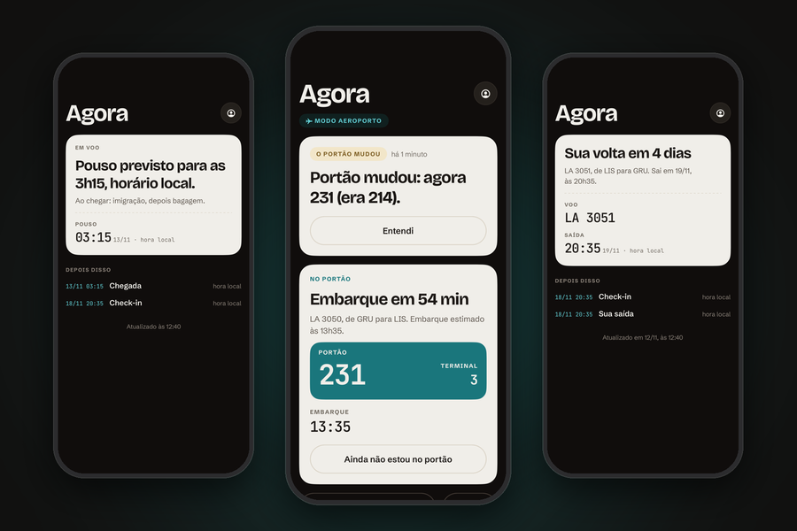
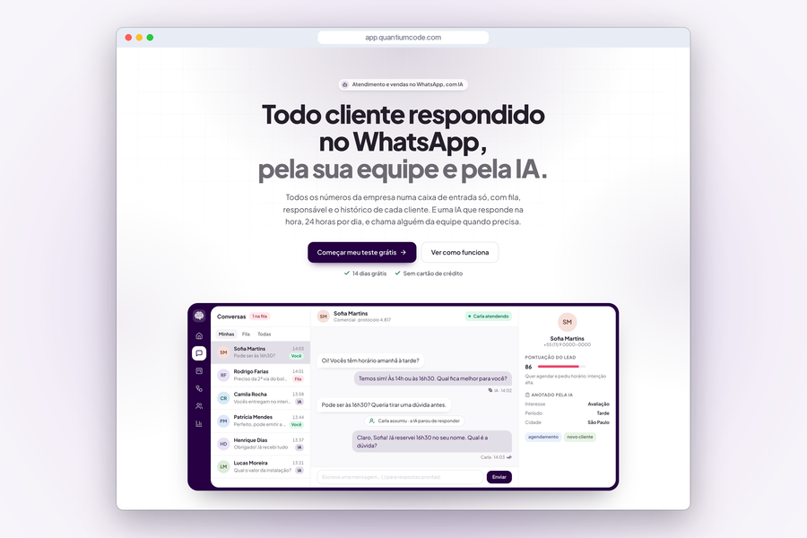
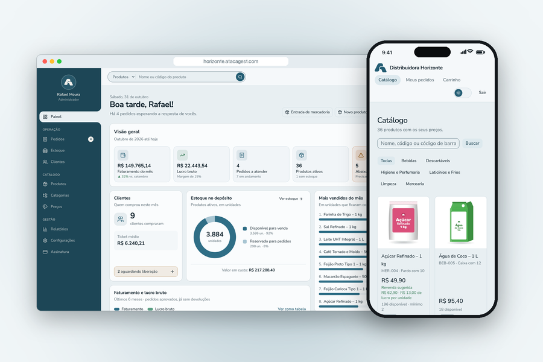

  

Quase todo o meu código é de clientes e de produtos da [QuantiumCode](https://quantiumcode.com/?utm_source=github&utm_medium=perfil), em repositórios privados. A cidade aqui embaixo é esse trabalho: um prédio para cada dia do último ano. [Read in English](#english)

  

## Trabalhos

**Comparador de voos, hotéis e pacotes com IA.** O mesmo voo em mais de 20 sites, lado a lado: a pessoa escreve a viagem numa frase e a IA preenche a busca. Fiz o site e os apps iOS e Android, no ar em [flyviron.com](https://flyviron.com).

<table>
  <tr>
    <td width="50%" valign="top">
      
      
<b>App de crédito para motoristas, com IA no WhatsApp.</b> O motorista de aplicativo contrata o crédito sem sair do celular. Fiz o app iOS e Android, o site com simulação, o painel da operação e a atendente de IA no WhatsApp.

    </td>
    <td width="50%" valign="top">
      
      
<b>Copiloto de viagem com IA para iPhone e Android.</b> Diz o que fazer em cada momento da viagem e avisa na tela de bloqueio quando o portão muda. Apps em SwiftUI e Kotlin, servidor em NestJS.

    </td>
  </tr>
  <tr>
    <td width="50%" valign="top">
      
      
<b>Atendimento no WhatsApp com IA, CRM e campanhas.</b> Todos os números da empresa numa caixa de entrada, com uma IA que responde e dá nota ao lead. No ar em <a href="https://app.quantiumcode.com">app.quantiumcode.com</a>.

    </td>
    <td width="50%" valign="top">
      
      
<b>ERP de atacado com portal de pedidos e estoque.</b> Cada cliente compra no portal com a própria tabela de preço, e o estoque reserva na hora. No ar em <a href="https://atacagest.com">atacagest.com</a>.

    </td>
  </tr>
</table>

Telas com dados fictícios, menos as do comparador, que é o site no ar.

## Contato

Orçamentos em [quantiumcode.com](https://quantiumcode.com/?utm_source=github&utm_medium=perfil) · [LinkedIn](https://www.linkedin.com/in/marcussviniciusa)

## English

I run QuantiumCode, a software studio in Brazil. We build web systems, iOS and Android apps, AI agents and WhatsApp automations for companies. Most of my code lives in private client repositories: the city above is that work, one building per day of the last year.
